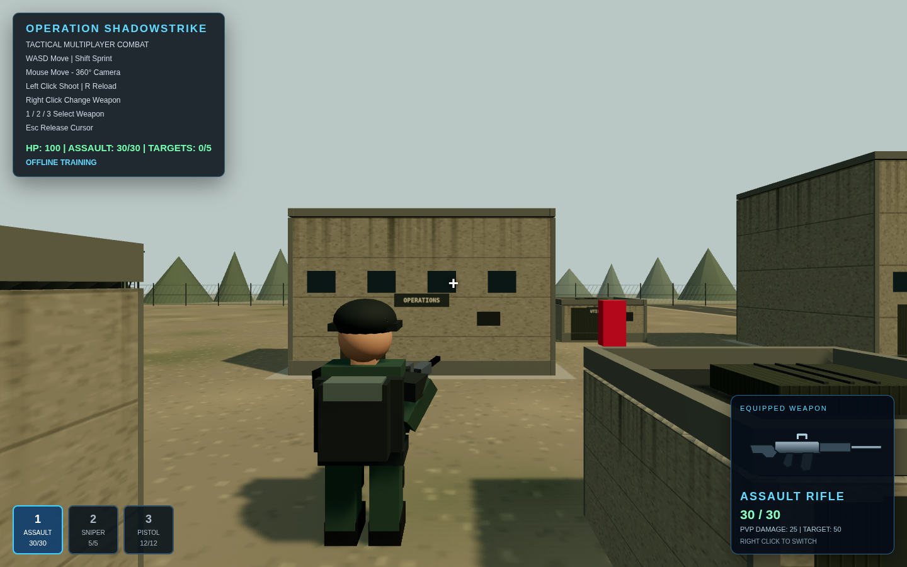
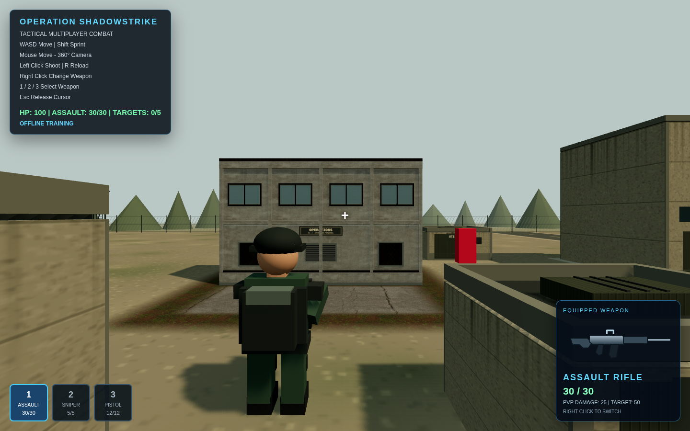
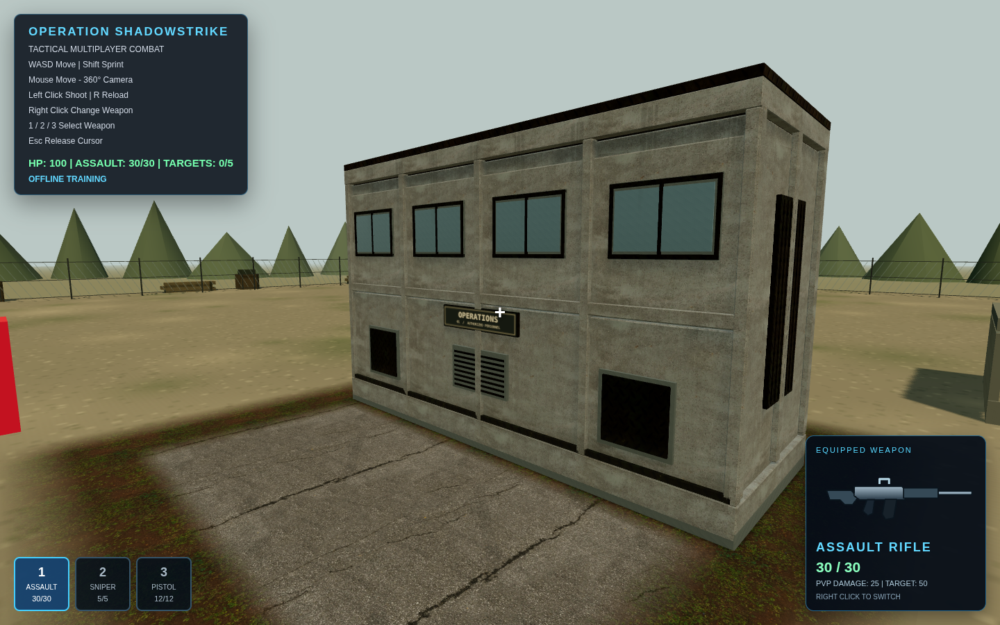

# Operations building: asset-driven proof of concept

This extends `feat/phase-one-military-compound`; it does not merge the branch.
Only the operations building at world x=-8, z=-7 and its immediate flat surface
surroundings are replaced. The other six building designs, the shared ground
outside this local patch, perimeter dressing and gameplay remain unchanged.

## What changed

An original Blender-authored modular GLB adds precast panel joints, structural
pilasters, floor bands, opaque framed glazing, sealed waist-height service panels,
vent louvers, roof parapets and low HVAC equipment. It is consolidated into five
material meshes, with small original signage and rain/damp weathering overlays.
The Blender construction script is retained for editing and regeneration.

Four checksum-verified CC0 Poly Haven material sets are self-hosted in
`public/assets/operations`: concrete, metal, asphalt and soil/vegetation. All four
have albedo, OpenGL normal, roughness and AO. The metal set also has metallic data.
Albedo uses sRGB; normal and packed ORM maps use non-color data. GLB maps use
flipY=false, world-scaled UVs and bounded anisotropy. Asphalt uses its published
3 m tile scale; other material tile sizes are art-directed rather than surveyed.
Original localized weathering and faded patch edges avoid changing unrelated
building materials. Asset download sources, authors, checksums and licensing are
in [ASSET-SOURCES.md](../public/assets/operations/ASSET-SOURCES.md).

The proof retains the Phase 1 daylight calibration: ACES filmic, exposure 1.05,
soft 2048² sun shadows and fog from 48 to 155 m. A small original PMREM-filtered
sky/ground reflection approximation lights the new metal/glazing only. It is not
a captured HDRI. Global lighting is unchanged so the before/after comparison
isolates this building and its local materials.

## Gameplay constraints

The original 8×3 m footprint and 5 m collision height remain authoritative. All
new building geometry fits inside local x=[-4,4], y=[0,5], z=[-1.5,1.5]. Flat
surface overlays are at most 4 mm above the old ground for depth separation and
do not participate in collisions or combat raycasts. No new doors, interiors,
cover, targets, movement mechanics or networking messages were introduced.
The old building remains visible while assets load, and stays as a fallback if
an asset fails. Loading the proof is nonblocking for gameplay.

## Matched screenshots

Before was captured on the original Phase 1 scene before integrating this proof.
After uses the same ordinary shoulder-camera transform: player (-8,0,3), camera
(-7.05,2.75,7.8), identity camera quaternion, 65° vertical FOV, 1440×900 viewport.
The normal camera-follow loop was allowed to run then frozen at that exact
transform for reproducibility. No gameplay camera changes were committed.

| Before | After |
|---|---|
|  |  |

Close-up uses a separate review-only camera to show material/detail work:

## Validation and limits

`npm run build` and all seven `npm test` checks passed. Chromium 154 with
SwiftShader passed pointer lock, forward movement, the operations-building wall
collision, the ±45 boundary, crosshair aiming/two-shot target elimination, reload,
weapon switching and sniper zoom with the new asset loaded. No page errors were
observed. Production preview also loaded the GLB, manifest and all 12 local PBR
map files with HTTP 200 and no external requests or page/asset errors.
The committed asset tests
verify the GLB bounds, UV presence, material batch count and integrity of all
self-hosted texture files. Existing multiplayer integration tests remain intact.
Screenshots are real Chromium/SwiftShader renders, not conceptual images. They do
not establish photorealism or FPS on ordinary desktop hardware. The other six
buildings, existing soldiers and cone-tree background remain Phase 1 artwork.
There are no unavailable material sets in the completed proof. Initial network
failures were resolved before obtaining and checksum-verifying the source maps.

The new texture set is approximately 12 MB on disk plus the approximately 390 KB
GLB; textures are transfer-compressed WebP/PNG, not KTX2 GPU-compressed. Ordinary
Windows GPU performance, mobile appearance and public-deployment multiplayer
remain unverified. No enemy AI or missions are included.
