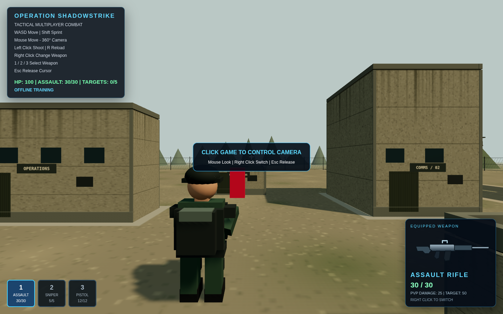
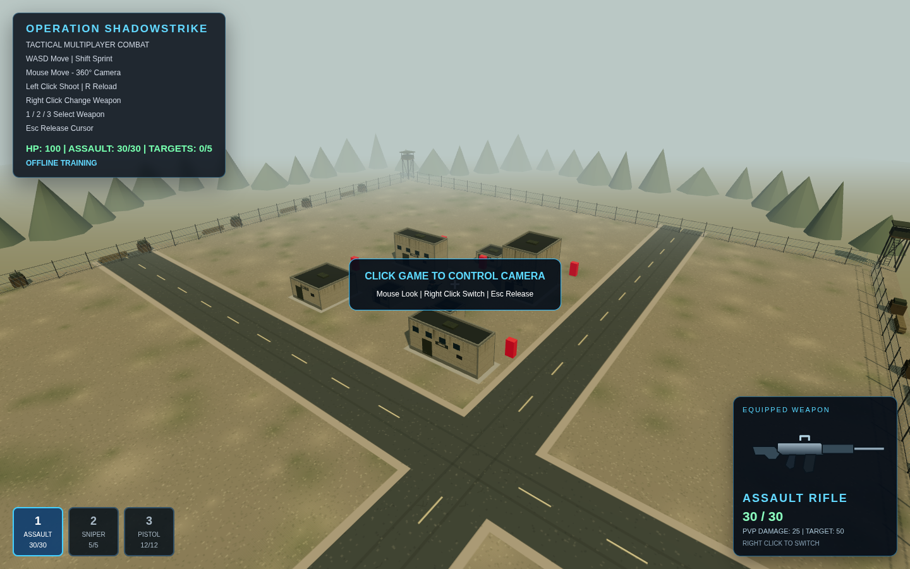

# Phase 1: military compound presentation

This change is limited to environment presentation. Buildings, materials, roads,
perimeter dressing and daylight replace the original untextured arena scenery.
Textures and signs are original deterministic Canvas artwork generated locally;
there are no asset downloads, paid assets or proprietary game assets.

## Design and collision constraints

- All seven original obstacle meshes remain the collision and firing-ray geometry.
  Their materials are hidden; detailed solid building shells render in their place.
  Roof parapets and equipment stay below the original obstacle height. Panels and
  opaque glazing are sealed surfaces, not entrances or playable interiors.
- Surface overlays are coplanar with the original walls. Polygon offset prevents
  depth fighting without moving panels out into walking/shooting lanes.
- The playable ground remains flat, with the same dimensions. Dirt, low grass
  variation, asphalt, tire wear, cracks and concrete pads are texture/bump effects,
  not physical elevation. Original road axes remain x=20 and z=19.
- Towers, fences, supply crates, sandbags and trees are outside the ±45 movement
  boundary. Previous collision-free props inside that boundary were relocated so
  the new scene does not imply solid cover that the game cannot enforce.
- Targets, movement code, weapons, server, Socket.IO and multiplayer code are
  unchanged. No AI or missions were added.

## Rendering budget

Repeated structures share unit-box geometry and materials: 534 pieces use eight
instanced material batches, plus 64 distant tree instances in one batch. Fence
wire uses one line batch. One shadow-casting sun replaces the original lighting
setup's sun and four decorative point lights. Daylight uses ACES filmic tone
mapping, soft shadow filtering, a 2048² shadow map fitted to the compound, and
atmospheric fog. Pixel ratio is capped at 1.5 to limit high-DPI fill cost.
Textures are generated once, including a 2048² ground map and 256² material maps.
No post-processing chain or per-frame environment generation was introduced.

## Validation performed

- `npm run build`: passed; Vite's nonfatal >500 kB bundle warning remains.
- `npm test`: all five existing integration tests passed, including separate
  Socket.IO clients, room lifecycle, movement, weapons, damage, reload and respawn.
- Headless Chromium 154 using SwiftShader: scene rendered with no page errors.
  Spawn and elevated review screenshots were captured and inspected.
- Browser-side bounds assertions checked all 598 environment instances: any
  above-ground instance intersecting the playable area fits in an original
  obstacle volume. All seven obstacle dimensions and five target positions were
  checked against the previous values.
- Browser interaction checks passed for pointer lock, forward movement, the
  existing wall collision and ±45 boundary, two-shot assault target elimination,
  reload, weapon switching and sniper zoom. Test-only scene/camera inspection was
  injected into browser responses; no debug hooks were added to production code.
- A sampled spawn frame reported 140 render calls and 16,094 rendered triangles
  via Three.js renderer.info. These are one-view counters, not FPS measurements
  or worst-case performance figures.

## Remaining limitations

Hardware-accelerated ordinary desktop performance, mobile devices, cross-browser
appearance and a deployed multiplayer session with the new scene have not been
validated. SwiftShader is software rendering and cannot establish a desktop FPS
claim. Art remains procedural and stylized; screenshots show the actual result,
not a claim of photorealism. Interiors, traversable towers, physical terrain
height and new cover would require a separately coordinated collision/gameplay
change and are intentionally excluded.

## Screenshots

Spawn with the existing player camera and HUD:

Elevated camera used only for review, showing the compound layout:

