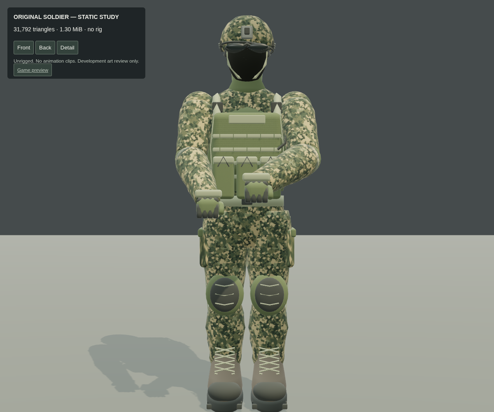
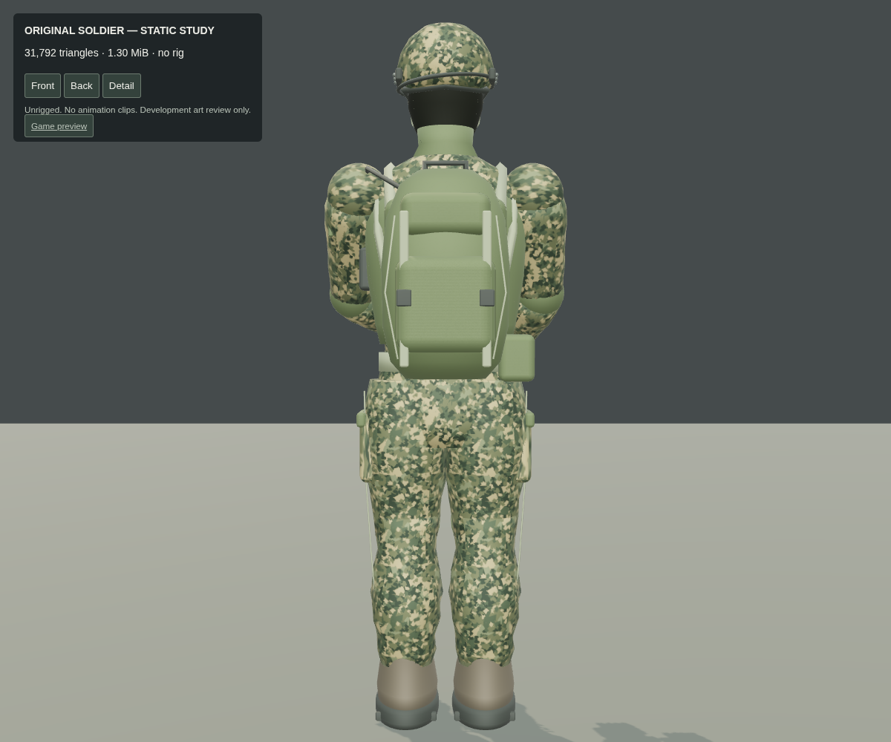
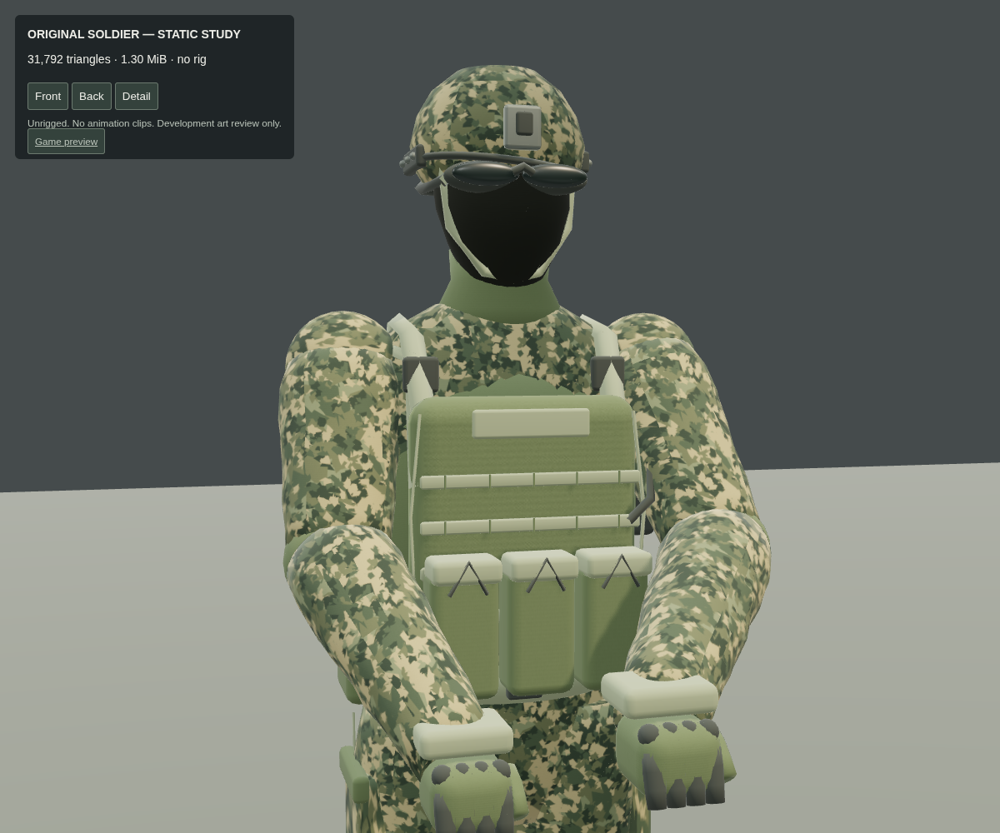
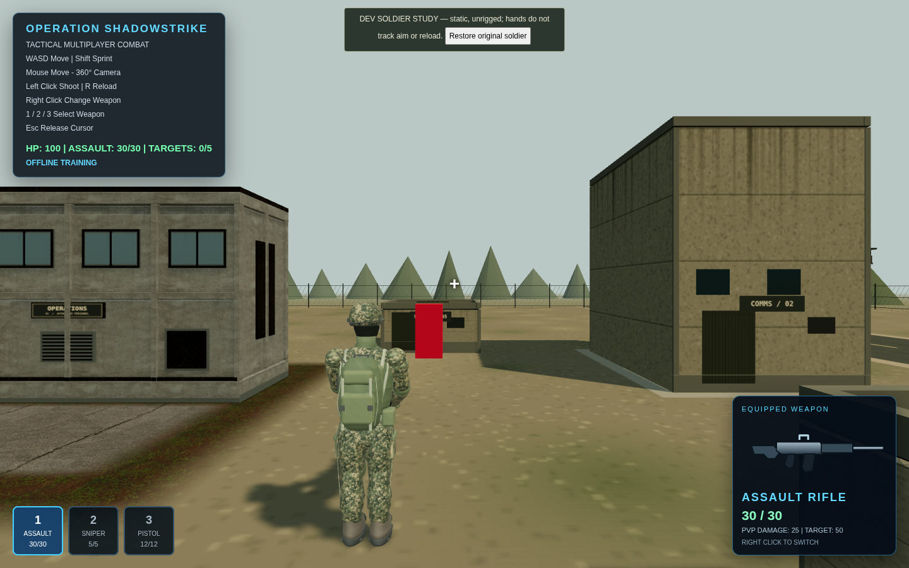

# Original soldier study: realism goal not achieved

This is a **partial result**, not a successful realistic-character replacement.
The original Blender pipeline produced a shaped, textured operator with a helmet,
covered face and goggles, uniform, plate carrier, pouches, boots, gloves, backpack,
radio and hydration tube. Close-up inspection still shows a stylized mannequin:
procedural anatomy, insufficient cloth sculpting and simplified soft equipment.
It should not be promoted to production or presented as photorealistic.

## Development preview only

Run `npm run dev` and append `?soldierPreview=1` to the game's URL. A visible banner
labels the study as static and unrigged. Use **Restore original soldier** to
restore the existing character immediately. The separate `soldier-preview.html`
page provides front, back, detail and orbit views for art review.

The option is guarded by `import.meta.env.DEV`. Neither the preview code, studio
page nor GLB is included in the production build. The asset lives in `dev-assets`,
not `public`. A production URL query cannot enable it. Default development also
keeps the original soldier without requesting the new model.

Only the local player's visible body changes when explicitly enabled. The
original root, controller, collision rules, camera, firing origin, weapon models,
weapon switching, recoil and aiming logic remain. Remote soldiers and Socket.IO
are untouched. New body meshes do not participate in raycasts. Loading failure
keeps the old soldier. Restoring the old body preserves the player's current
position and equipped weapon.

## Actual limitations

The GLB is static: **no skeleton, skinning, animation clips or hand IK**. It does
not walk, follow weapon aim or perform a reload pose. Existing gameplay weapon
updates still execute separately; that does not make this mesh animated. The
existing procedural weapon visuals were not upgraded. This is an art review mode,
not a fully playable replacement animation system.

The code-driven authoring attempt did not meet the requested realistic quality.
Blender is available, but a convincing result needs an anatomy/cloth sculpt and
retopology pass that this generated study does not provide. A character artist
can use the supplied source as a starting point, but the result may need major
reworking. The triangle budget must not be treated as acceptance of the art.

## Measurements and provenance

31,792 rendered triangles, 21,960 exported vertices, 8 material meshes and
1,367,008 bytes (1.30 MiB) including original embedded textures. Albedo maps are
1024²; roughness and woven normal maps are 512². There are no external asset
sources or proprietary game assets.

See [asset notes and licensing](../dev-assets/soldier-prototype/ASSET-NOTES.md) and
[export metrics](../dev-assets/soldier-prototype/metrics.json).

## Validation

- `npm run build`: passed; existing nonfatal bundle-size warning remains.
- `npm test`: all 8 tests passed, including existing multiplayer/combat tests and
  a new check of actual GLB triangle count, bytes, embedded maps and no rig/clips.
- Production-output inspection: no preview code, studio page or model in `dist`.
- Chromium 154 / SwiftShader: front, back, detail and normal game-camera renders
  captured and inspected. No game page errors during the preview interaction test.
- Preview enabled: pointer lock, movement, original wall collision and ±45 bounds,
  crosshair aiming/two-shot target elimination, reload, weapon switching and
  sniper zoom passed. Restore-original preserved position and selected pistol.
- Default development requested no preview asset. A production URL with the query
  also requested no preview asset or UI. A simulated missing GLB retained the
  original soldier and produced the expected fallback warning.

Software rendering does not establish ordinary Windows GPU performance or FPS.
Mobile/cross-browser appearance, animation quality and public multiplayer with
this local art preview have not been validated. A static study also cannot predict
future skinned-character animation cost.

## Screenshots of the actual unapproved study

Front:

Back:

Close-up:

Existing third-person game camera, with the development warning visible:

